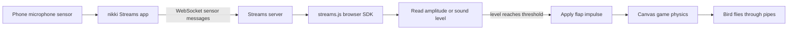

# Scream Bird: Proof of Concept

## Overview

Scream Bird is a browser game in which a loud sound detected by a phone microphone makes the bird flap. The phone runs nikki Streams and sends microphone sensor readings to the laptop over a WebSocket. The laptop browser reads those numbers and applies them to a Flappy Bird style game built with HTML Canvas and JavaScript.

This prototype demonstrates the complete input-to-action path: **phone microphone → Streams sensor data → browser SDK → sound threshold → bird flap → game physics**. It receives sensor values only; it does not capture, transmit, or store microphone audio.

## Demonstration flow



## What is needed

- A laptop with a modern browser and this project folder.
- A phone running nikki Streams, with a session that has the Microphone sensor enabled and streaming.
- Phone and laptop on a network that can reach the Streams WebSocket server.
- The Streams server address and the session ID shown by the Streams workflow.
- A local HTTP server for the game. A hosted HTTPS page requires a secure WebSocket endpoint (`wss://`) on the Streams server.

The game is a standalone web page. It does not inject code into or modify the official Flappy Bird website.

## Run the prototype

1. Start the Microphone sensor and streaming session in nikki Streams.
2. In the project folder, run `py -m http.server 8000` in PowerShell (or `python -m http.server 8000`).
3. On the laptop, open `http://localhost:8000`.
4. In **Phone microphone**, enter the Streams server address and session ID, then choose **Connect phone**. The address already in the field is a project default; replace it if your Streams server uses another address.
5. Confirm the status reads **Phone connected · listening** and that **MIC LEVEL** changes when you make a sound.
6. Adjust **FLAP WHEN LEVEL REACHES** until ordinary room noise stays below the line and a loud sound crosses it. **Calibrate to room noise** sets the threshold approximately 10 dB above the current reading.
7. Choose **Start flight**, then make a short loud sound to flap. Silence lets gravity pull the bird down. Space, Up Arrow, and a click/tap on the canvas are manual fallbacks.

The session ID field is intentionally empty in the source. The application saves the entered server, session ID, and threshold in that browser's local storage for convenience. Do not publish or share a live session ID.

## Key implementation snippets

The excerpts below are shortened to show the main interfaces. The complete implementation is in [`game.js`](game.js), and the vendored browser SDK is [`streams-sdk.js`](streams-sdk.js).

### 1. Load the SDK as an ES module

`index.html` loads the game as a module, so it can import the SDK:

```html
<script type="module" src="game.js"></script>
```

```js
import { SDK } from './streams-sdk.js';
```

The SDK bundle is the browser build of nikki-build's `streams.js` package. The browser receives sensor messages; the phone app remains responsible for microphone access and sensor streaming.

### 2. Initialize and connect to the phone session

The connection handler reads the user's server and session values, initializes the SDK once per page session, creates a device, and listens for status and data events:

```js
const session = sessionIdInput.value.trim();
const scheme = location.protocol === 'https:' ? 'wss' : 'ws';
const address = `${scheme}://${serverHost}`;

if (!initializedSession) {
  SDK.initialize(session);
  initializedSession = session;
}
streamsDevice = SDK.createDevice(address, (event) => {
  if (event.type === 'statusChange' && event.data === 'connected') {
    setConnection('connected', 'Phone connected · listening');
  } else if (event.type === 'statusChange' && event.error) {
    setConnection('error', event.error.message || 'Streams SDK connection error');
  }
  if (event.type === 'data') {
    const reading = findAudioReading(event.data);
    if (reading) onLevel(reading.db);
  }
});

await streamsDevice.connect();
```

In the full project, the address scheme is selected from the page protocol, an eight-second connection timeout is used, and the UI displays connection errors. Use `wss://` when connecting from an HTTPS-hosted page; browsers block insecure `ws://` connections from HTTPS pages.

### 3. Find a microphone reading in a sensor message

Streams message shapes can vary. `findAudioReading()` walks nested objects and arrays, looks for microphone/audio-related context and recognized numeric level fields, then normalizes amplitude values between 0 and 1 into decibels relative to full scale (dBFS):

```js
if (/(amplitude|rms|ratio)/i.test(key) && value > 0 && value <= 1) {
  return { db: 20 * Math.log10(value), scale: 'dbfs' };
}
return { db: value, scale: value < 0 ? 'dbfs' : 'spl' };
```

Positive microphone readings are treated as dB sound-pressure-level values; negative readings and normalized amplitudes use dBFS. The meter and threshold slider switch scales when the first microphone reading arrives. If the connection works but the meter remains blank, open **Sensor message details** and adapt `findAudioReading()` to the exact field name and nesting shown in the incoming message.

### 4. Turn a loud level into a flap

`onLevel()` compares each reading to the adjustable threshold. A short quiet period rearms the trigger; sustained loud sound repeats the flap after a cooldown:

```js
const above = db >= threshold();
if (!above) {
  aboveThreshold = false;
  quietTimer = performance.now();
} else if (performance.now() - quietTimer > 150 &&
           (!aboveThreshold || performance.now() - lastFlap > 520)) {
  aboveThreshold = true;
  flap('voice');
}
```

The game's `flap()` function applies an upward velocity impulse. Between flaps, the animation loop applies gravity and moves the bird and pipes:

```js
vy += gravity;
bird.y = Math.max(-10, bird.y + vy);
// A flap sets vy to a negative value, moving the bird upward.
```

The same loop checks pipe and screen-edge collisions, increments the score after passing a pipe, and ends the flight after a collision. The Canvas game is in `game.js`; the visual controls and meter are in `index.html` and `styles.css`.

## Prototype acceptance checklist

- The game page loads locally over HTTP and shows the start screen.
- The phone connects and the UI reports **Phone connected · listening**.
- The live level display changes when the phone detects different sound levels.
- A level above the selected threshold triggers an upward flap.
- Quiet allows the bird to fall and rearms the sound trigger.
- Pipes move, collisions end a flight, and passing a pipe increases the score.
- Keyboard and pointer controls can start or replay a flight without the phone.
- No microphone recording is created by the browser game.

## Limits and next steps

- Sensor field names and units depend on the Streams payload. The parser supports common microphone, amplitude, level, and decibel field names; inspect the live message details if the app uses another shape.
- Decibel readings from different phone microphones may need threshold calibration.
- A public static HTTPS deployment can connect only if the Streams server supports `wss://` and is reachable by the browser. The current laptop-and-phone same-network setup is the simplest demonstration path.
- The session ID is stored in local browser storage after entry. Clear the field/storage before sharing the browser profile or use a fresh session ID.
- This is a front-end proof of concept. It has no user accounts, server-side gameplay, cloud storage, or deployment configuration.

## Project files

| File | Purpose |
| --- | --- |
| `index.html` | Game canvas, connection form, meter, and controls |
| `styles.css` | Responsive page styling |
| `game.js` | Streams connection, sensor parsing, threshold logic, and game physics |
| `streams-sdk.js` | Browser SDK bundle for nikki Streams |
| `flappybird*.png`, `*pipe*.png` | Bird, pipe, and background artwork |
| `sfx_*.wav` | Game sound effects |
| `README.md` | Short setup guide |
| `Scream-Bird-v1.zip` | Packaged project snapshot |
